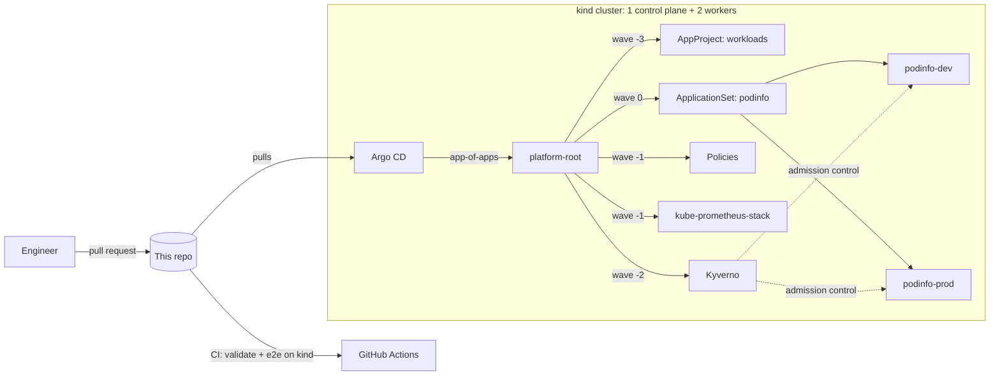

# GitOps Platform on kind

[](https://github.com/Ahmadshen/gitops-platform-kind/actions/workflows/ci.yml)

A production-style **GitOps platform that runs on your laptop** for free: Argo CD app-of-apps, Kyverno policy-as-code, environment promotion by pull request, and Prometheus/Grafana. Every push spins it up on a fresh kind cluster in CI and proves it works.

```bash
make e2e   # kind cluster → Argo CD → platform + apps → smoke tests (~5 min)
```

## What the smoke test proves

These run on every push (`scripts/smoke-test.sh`):

```text
PASS: prod runs 2 ready replicas
PASS: dev serves podinfo 6.15.0
PASS: prod serves podinfo 6.14.1
PASS: Kyverno blocked a :latest image
PASS: Argo CD reverted manual scale-up (5 -> 2)
```

| Claim | How it's proven |
|---|---|
| Environments run what Git says | Each env's `/version` endpoint must match the version pinned for it in Git |
| Guardrails are enforced, not advisory | A `:latest` pod is submitted and must be **rejected by Kyverno** at admission |
| Git is the source of truth | Prod is scaled to 5 by hand; Argo CD must **self-heal back to 2** |
| Prod is highly available | 2 ready replicas spread across nodes |

## Architecture



- **App-of-apps with sync waves.** The project comes first, then Kyverno, then the policies, then the workloads, so no workload is admitted before the guardrails exist. A health check on `Application` resources (in `bootstrap/argocd-values.yaml`) makes the waves actually wait.
- **One ApplicationSet, many environments.** Each env gets the podinfo chart at its own version (`bootstrap/root/values.yaml`) plus its own values (`apps/podinfo/envs/<env>/values.yaml`) through Argo CD multi-source.
- **Least-privilege project.** The `workloads` AppProject can deploy only approved sources into `podinfo-*` namespaces. Its only cluster-scoped permission is creating its own namespace.

## Promotion is a pull request

```diff
 podinfo:
   envs:
     - name: dev
       chartVersion: 6.15.0
     - name: prod
-      chartVersion: 6.14.1
+      chartVersion: 6.15.0
```

Merge, and Argo CD rolls prod forward with no kubectl and no pipeline credentials into the cluster. Tested locally: prod moved to 6.15.0 **12 seconds** after the commit was picked up. Rollback is `git revert`.

## Guardrails (Kyverno, enforced)

| Policy | Blocks |
|---|---|
| `require-requests-limits` | Containers without CPU/memory requests and a memory limit |
| `disallow-latest-tag` | `:latest` or untagged images |
| `require-run-as-nonroot` | Containers that could run as root |
| `disallow-privilege-escalation` | `allowPrivilegeEscalation` not explicitly false |

System namespaces are excluded. The app values (`apps/podinfo/envs/*`) run as non-root with a read-only root filesystem, all capabilities dropped and a RuntimeDefault seccomp profile, so they pass every policy.

Policies are tested like code (`tests/policies`): **25 Kyverno CLI test cases** check that every violation is caught by exactly the right policy, compliant pods pass, and system namespaces are skipped. `make validate` also renders the real app for each environment and checks it against every policy, so a values change that would be blocked in the cluster fails in CI first.

## Run it

Requirements: Docker, [kind](https://kind.sigs.k8s.io), kubectl, Helm, jq. Versions are pinned in `versions.env`.

```bash
make up          # cluster + Argo CD + root app (set MONITORING=false for a lighter run)
make wait        # until every Application is Synced + Healthy
make smoke       # the checks above
make ui          # Argo CD at http://localhost:8080
make grafana     # Grafana at http://localhost:3000
make down
```

`make up` deploys **the exact commit you have checked out** (`REVISION=$(git rev-parse HEAD)`) from your GitHub remote, so push first. Override with `REPO_URL=` / `REVISION=`.

## CI

| Job | What it does |
|---|---|
| **validate** | `helm lint` the root chart, run Kyverno policy unit tests, check the rendered apps against the policies, kubeconform against Kubernetes + Argo CD + Kyverno CRD schemas |
| **e2e** | A fresh kind cluster in the runner: install Argo CD, point it at **the commit under test**, wait for every Application to be Synced and Healthy, run the smoke tests. Dumps app status and repo-server logs on failure. |

## Lessons baked in

- **Large CRDs show false "OutOfSync"** under client-side diff, even with server-side apply. Kyverno and kube-prometheus-stack use `ServerSideDiff=true`.
- **Helm test hooks aren't deployed by Argo CD**, so compliance checks render with `--skip-tests`. Otherwise the chart's test pods fail the policies even though nothing violating ever reaches the cluster.
- **`CreateNamespace` needs the project to allow `Namespace`**, which is the single cluster-scoped exception granted to `workloads`.

## Roadmap
- [ ] Sealed Secrets / External Secrets with a local backend
- [ ] Argo Rollouts canary for prod with Prometheus analysis
- [ ] Gateway API ingress instead of port-forward
- [ ] Policy reports surfaced in Grafana

## License
MIT
